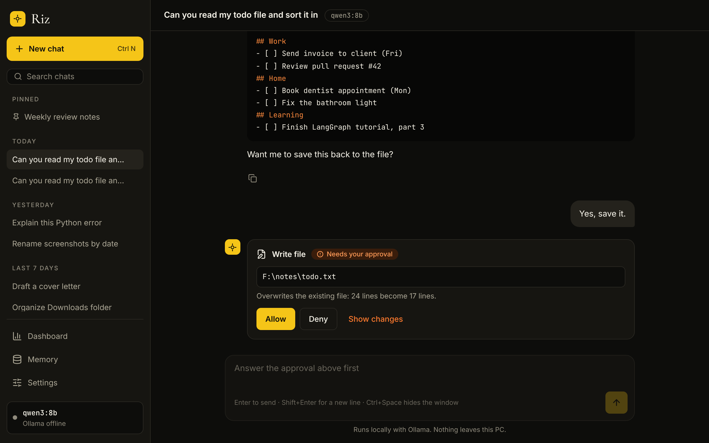
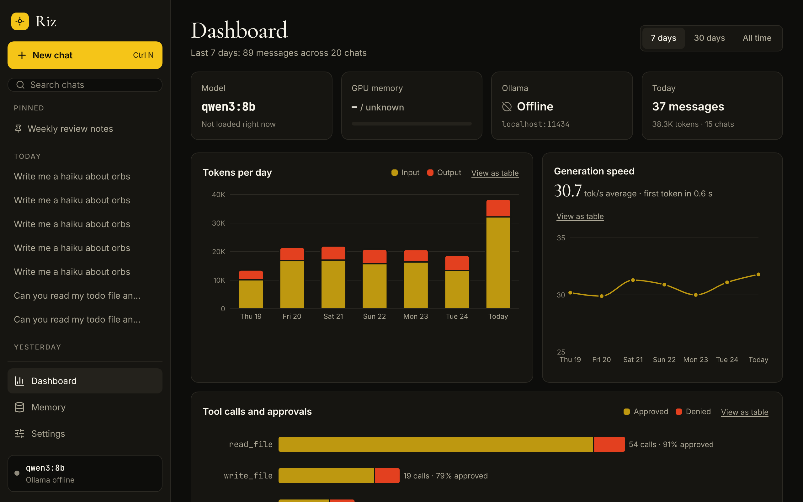
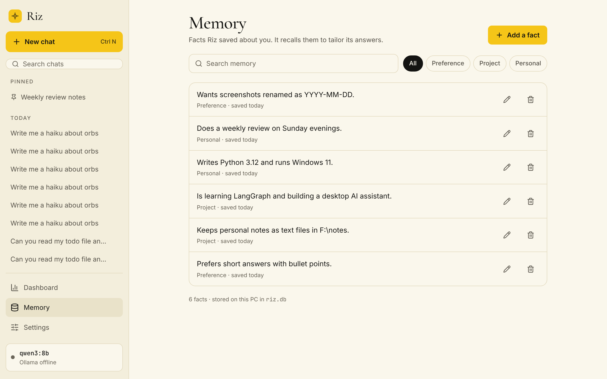
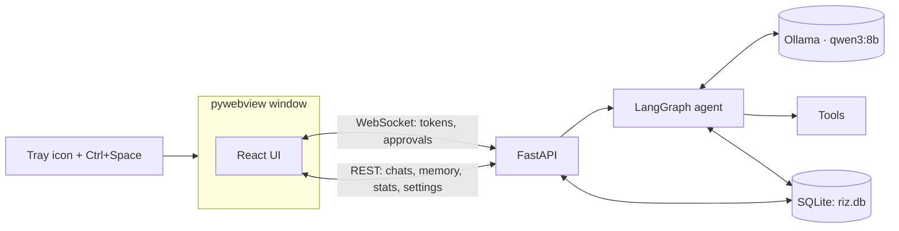

# Riz

**A private AI assistant for Windows that runs entirely on your own GPU and asks before it touches anything.**

[](https://github.com/SyedSameerRizvi/Riz-Personal-AI-Assistant/actions/workflows/ci.yml)




Riz is a desktop chat assistant that can read, write and delete files and run PowerShell commands on your PC. It uses **Qwen 3 8B through Ollama**, so nothing leaves the machine: no cloud model, no accounts, no web access. Every action that could change something shows an approval card first, and nothing runs until you click **Allow**.

## Features

- **Fully local.** The model runs on your GPU through Ollama. Chats, memory and stats live in one SQLite file.
- **Acts on your PC, with your permission.** Read, write and delete files, and run PowerShell, each behind an approval card.
- **Streaming chat** with Markdown, highlighted code blocks, copy buttons, Stop and Regenerate, and speed per reply (tok/s).
- **Memory.** Riz saves facts about you (preferences, projects, personal details) and recalls them to tailor answers. You can browse, search, edit and delete them.
- **Usage dashboard.** Tokens per day, generation speed over time, tool calls with approval rates, GPU memory and Ollama status.
- **Lives in the tray.** Starts with Windows, and `Ctrl+Space` shows or hides the window from anywhere.
- **Dark and light themes** that follow Windows.
- **Live thinking orbs.** A dotted orb animates while Riz thinks and while it writes, using [thinking-orbs](https://github.com/Jakubantalik/thinking-orbs) by Jakub Antalik (MIT).

| Dashboard | Memory |
|---|---|
|  |  |

## How approvals work

| Tool | Approval |
|---|---|
| `recall_memory` | Runs freely |
| `save_memory` | Runs freely; the chat shows a "Saved to memory" note |
| `read_file` | **Allow / Deny / Pick another file…** (opens a Windows file picker) |
| `write_file` | **Allow / Deny**, with the path, the line-count change and a "Show changes" diff |
| `delete_file` | **Allow / Deny**; always goes to the Recycle Bin, never deleted for good |
| `run_command` | **Allow / Deny**, showing the full PowerShell command |

Under the hood, the agent is a LangGraph graph with a model node and a tools node. When the model asks for a tool that needs approval, the tools node calls LangGraph's `interrupt()` and the UI shows the card. Your answer resumes the graph with `Command(resume=...)`.

LangGraph re-runs the whole node on every resume, so the tools node collects **every** approval first and only then runs the tools. Nothing ever executes twice. A denial goes back to the model as "The user denied this action." so it can respond sensibly. The pending card is stored in the checkpoint, so it survives an app restart, and new messages are blocked until you answer it.

Limits: `read_file` returns at most 20 KB to the model; `run_command` times out after 60 s and caps output at 10,000 characters.

## Architecture



One Python process starts everything: the FastAPI server on `127.0.0.1` (a free local port, never exposed to the network), the pywebview window, the tray icon and the hotkey listener.

- **Context:** `num_ctx` 8192; history is trimmed to about 6,000 tokens before each model call.
- **History:** LangGraph's SQLite checkpointer, one thread per chat, in the same `riz.db`.
- **Logging:** every model call (tokens, time to first token, total time) and every tool call (tool, arguments, decision) is logged to feed the dashboard.
- **Data folder:** `%APPDATA%\Riz`, overridable with `RIZ_DATA_DIR`.

The full design is in [`docs/spec.md`](docs/spec.md).

## Requirements

- Windows 10 or 11
- An NVIDIA GPU with 6 GB of VRAM or more (built on a GTX 1660 Super)
- [Ollama](https://ollama.com)
- Python 3.12
- Node 22 (the test tools need it; Node 20 reached end of life in April 2026)

## Setup

1. Install Ollama and download the model. To keep models off a small system drive, set `OLLAMA_MODELS` first (for example `F:\ollama-models`) and restart Ollama.

   ```powershell
   ollama pull qwen3:8b
   ```

2. Install the backend.

   ```powershell
   cd backend
   python -m venv .venv
   .venv\Scripts\activate
   pip install -e ".[dev]"
   ```

3. Build the frontend.

   ```powershell
   cd frontend
   npm ci
   npm run build
   ```

## Run

```powershell
cd backend
.venv\Scripts\activate
python -m riz
```

The first launch adds a shortcut to your Startup folder so Riz starts with Windows (hidden in the tray). You can turn that off in **Settings**. Closing the window hides it to the tray; use the tray menu's **Quit** to exit.

### Development

Run the API with reload and the Vite dev server side by side:

```powershell
# terminal 1
cd backend
uvicorn riz.server:dev_app --factory --reload --port 8765

# terminal 2
cd frontend
npm run dev
```

## Tests

The backend tests use a scripted fake chat model, so they run without Ollama or a GPU.

```powershell
ruff check backend
pytest backend

cd frontend
npx vitest run
```

## License

[MIT](LICENSE)
