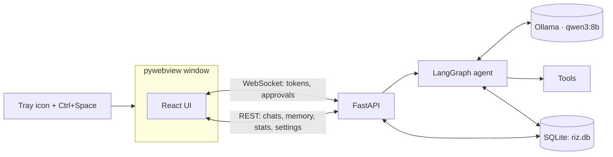

# Riz — Spec

Riz is a personal AI agent for Windows. It runs entirely on your PC: a local model through Ollama, a desktop window that pops up with a hotkey, and tools that can read and change files only after you approve them.

Status: design agreed 2026-11-25. UI mockups: https://claude.ai/artifact/Fqrddntqwhg88po5qGQTum

## Goals

- A chat assistant that can act on the PC (files, commands) with you approving every action that touches the system.
- Fully local and free: no cloud model, no web access, no accounts. Nothing leaves the PC.
- Starts with Windows, lives in the tray, `Ctrl+Space` shows or hides it.
- A polished UI with chat history, a usage dashboard and an editable memory.
- A public portfolio project: clean repo, README with demo GIF and architecture diagram, tests, CI.

## Non-goals (v1)

- Web search or any internet tool.
- Voice input or output.
- Controlling other apps (clicking, typing).
- Multiple users, sync, mobile.
- Editing past messages, branching chats, file attachments.
- A separate quick-ask bar (the hotkey toggles the one main window).
- A packaged `.exe` installer (run from source for now).

## Hardware constraints

| Part | Value | Consequence |
|---|---|---|
| GPU | GTX 1660 Super, 6 GB | 7–8B model at 4-bit fits fully; context capped near 8K tokens |
| RAM | 16 GB | — |
| F: | HDD, 309 GB free | Fine for Ollama models (loaded once into VRAM) |
| C: | NVMe SSD, 39 GB free | Keep models off it |

AirLLM was evaluated and rejected: it re-reads every layer from disk per token, which on this HDD means minutes per token. It may return as an optional background "deep think" mode if an NVMe drive for models is added.

## Stack

| Layer | Choice |
|---|---|
| Model runtime | Ollama, models in `F:\ollama-models` (`OLLAMA_MODELS`) |
| Model | Qwen 3 8B, 4-bit (name set in Settings; re-check best 7–8B tool-calling model before first download) |
| Agent | LangGraph + `langchain-ollama` |
| Backend | Python 3.12, FastAPI, WebSocket for streaming, SQLite |
| Frontend | React + TypeScript + Vite + Tailwind + shadcn/ui |
| Window | pywebview loading the local FastAPI URL |
| Tray / hotkey | `pystray` for the tray icon, a global-hotkey library for `Ctrl+Space` |
| Recycle Bin | `send2trash` |

## Architecture



One Python process starts everything: the FastAPI server on `127.0.0.1` (random free port, never exposed to the network), the pywebview window, the tray icon and the hotkey listener. A Startup-folder shortcut launches it at login.

## Agent

- LangGraph graph: model node → tool node → back to model, until the model answers without a tool call.
- Approval: before any tool that needs it, the graph calls `interrupt()` with the tool name and arguments. The UI shows an approval card; the user's answer resumes the graph. A denial is returned to the model as the tool result ("The user denied this action") so it can respond sensibly.
- Chat history: LangGraph's SQLite checkpointer, one thread per chat.
- Context: `num_ctx` 8192. When a chat exceeds it, the oldest messages are dropped from what is sent to the model (they stay in history). `shortcut: no summarization, upgrade if long chats lose important context.`
- System prompt: who Riz is, the tool rules, today's date, and the facts from memory.

## Tools and approval policy

| Tool | What it does | Approval |
|---|---|---|
| `recall_memory` | Search saved facts | Runs freely |
| `save_memory` | Save a fact about the user | Runs freely; the chat shows a small "Saved to memory: …" note |
| `read_file` | Read a text file | Card: **Allow / Deny / Pick another file…** |
| `write_file` | Create or overwrite a text file | Card: **Allow / Deny**, shows path and line-count change, "Show changes" diff |
| `delete_file` | Delete a file | Card: **Allow / Deny**; always to the Recycle Bin, never permanent |
| `run_command` | Run a PowerShell command, return output | Card: **Allow / Deny**, shows the full command |

- Any path on the PC is allowed; the approval card is the safety gate.
- "Pick another file…" opens a native Windows file picker; the chosen path replaces the model's.
- `read_file` caps the content returned to the model (default 20 KB) so a large file cannot blow the context window.
- `run_command` has a timeout (default 60 s) and caps captured output.

## Data (SQLite, `riz.db` in the app data folder)

LangGraph's checkpointer tables hold message history. Riz adds:

- `chats`: `id`, `title`, `pinned`, `created_at`, `updated_at`
- `memories`: `id`, `text`, `kind` (preference / project / personal), `source_chat_id`, `created_at`, `updated_at`
- `model_calls`: `id`, `chat_id`, `model`, `started_at`, `input_tokens`, `output_tokens`, `first_token_ms`, `total_ms`
- `tool_calls`: `id`, `chat_id`, `tool`, `args_json`, `decision` (auto / allowed / denied), `created_at`
- `settings`: `key`, `value`

Token counts and timings come from Ollama's response metadata, logged on every model call.

## Backend API

WebSocket `/ws`:

- Client → server: `send {chat_id, text}`, `approve {chat_id, decision: allow|deny|pick, path?}`, `stop {chat_id}`, `regenerate {chat_id}`
- Server → client: `token {chat_id, text}`, `tool_request {chat_id, tool, args}`, `tool_result {chat_id, tool, decision, summary}`, `done {chat_id, stats}`, `error {chat_id, message}`

REST under `/api`:

- `chats`: list (grouped by the UI), create, rename, pin, delete (with confirmation in the UI), get messages
- `memory`: list, search, create, update, delete
- `stats?range=7d|30d|all`: data for the dashboard
- `status`: Ollama running, loaded model, VRAM used / total
- `settings`: get, update

## UI

Matches the mockups: clean and minimal, Inter + JetBrains Mono, one accent colour, dark and light themes following Windows.

- **Sidebar:** New chat, search, chats grouped Pinned / Today / Yesterday / Last 7 days / Older, rename, pin, delete. Links to Dashboard, Memory, Settings. Model and Ollama status at the bottom.
- **Chat:** streamed replies, markdown, highlighted code with copy, Stop, Regenerate, per-reply speed, approval cards inline, resolved tool calls collapsed ("Allowed by you"), a small "Saved to memory: …" note whenever Riz saves a fact (links to the Memory page).
- **Dashboard:** status tiles (model, GPU memory, Ollama, today), tokens per day (input/output), generation speed over time, tool calls with approval rates; 7 days / 30 days / All time.
- **Memory:** list of saved facts with kind filter, search, add, edit, delete.
- **Settings:** model name, theme (system / light / dark), hotkey, start with Windows.

## Repo layout

```
docs/spec.md
backend/riz/      main.py (entry), server.py, agent.py, tools.py, db.py, stats.py
backend/tests/
frontend/         Vite + React app
README.md
```

## Testing

- Backend (pytest): tool functions, the approval flow (interrupt → resume with allow, deny and pick), stats queries, chat and memory CRUD. The model is faked so tests run without Ollama.
- Frontend: component tests for the approval card and the chat stream (Vitest).
- CI (GitHub Actions): lint and tests on every push.
- Manual: Playwright pass over the UI in a browser (desktop and narrow widths).

## Open questions

- Hotkey conflicts: `Ctrl+Space` is used by some IMEs and editors; Settings lets you change it.

## Later

- `.exe` packaging.
- Quick-ask bar.
- Voice.
- AirLLM "deep think" mode (needs an NVMe drive for models).
